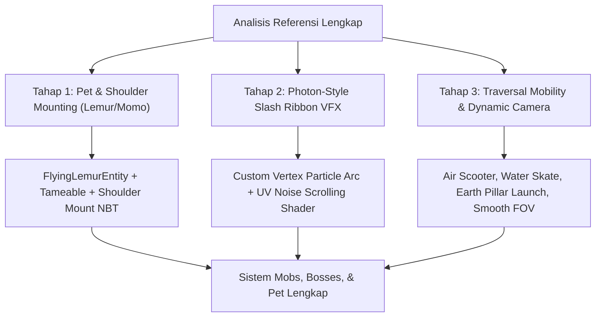

# Master Reference Library & Technical Analysis: Avatar Elements Mod

> **Document Version:** 1.0.0  
> **Target Platform:** Minecraft Java Edition 1.21.1 (Fabric Mod Loader)  
> **Status:** Comprehensive Reference Architecture & Implementation Guide  
> **Repository:** `d:\repo\Minecraft Mod & Rp`

---

## Executive Summary

Dokumen ini merekapitulasi, membongkar secara teknis (*reverse-engineering & bytecode analysis*), dan mensintesis seluruh sumber referensi yang telah diberikan oleh pengguna ke dalam repositori `d:\repo\Minecraft Mod & Rp\reference\`, repositori GitHub, kanal tutorial YouTube, dan paket arsip aset. 

Tujuan utama dokumen ini adalah mengubah temuan teknis dari setiap referensi menjadi **panduan arsitektur konkrit (*actionable blueprints*)** untuk mod **Avatar Elements**, mencakup:
1. **Sistem Pet & Shoulder Mounting** (dari `AvatarFlyingLemur-1.12.2-1.1.jar`).
2. **Arsitektur Jaringan & Sinkronisasi Paket** (dari `common-networking-fabric-1.0.21-1.21.1.jar`).
3. **Engine VFX Partikel GPU, Slash Ribbon, & Shaders** (dari `photon-fabric-1.20.1-1.1.17.jar`, `Low-Drag-MC/Photon.git`, dan tutorial KilaBash).
4. **Mekanika Elemental Traversal, HUD, & Moveset Bending** (dari video analisis *"This AVATAR Mod Just UPDATED..."*).
5. **Katalog Aset Produksi & Entitas Pilot** (dari `Avatar_Elements_Asset_Production_v1-v3.zip` dan `avatar_elements_batch2_pilot_review.zip`).

---

## 1. Analisis Dekonstruksi JAR Referensi

```
┌──────────────────────────────────────────────────────────────────────────────────────────────────┐
│                                 REFERENCE DECONSTRUCTION MATRIX                                  │
├──────────────────────────────┬────────────────────────┬──────────────────────────────────────────┤
│ Source Reference             │ Core Architecture      │ Implementation Value for Avatar Elements │
├──────────────────────────────┼────────────────────────┼──────────────────────────────────────────┤
│ AvatarFlyingLemur-1.12.2     │ Tameable + Shoulders   │ Companion Pet System, Shoulder Riding,   │
│                              │ Capability + ModelLemur│ Momo Glide AI & Interaction Modes        │
├──────────────────────────────┼────────────────────────┼──────────────────────────────────────────┤
│ common-networking-fabric     │ Multiplatform Payload  │ Low-Latency Combat Packet Dispatch,      │
│                              │ Dispatcher + Context   │ Server-Client Animation & Skill Sync     │
├──────────────────────────────┼────────────────────────┼──────────────────────────────────────────┤
│ photon-fabric-1.20.1         │ Compute Shader Ribbons │ Catmull-Rom Splines, Slash Arcs, Bloom,   │
│                              │ & Unreal Composite     │ Separable Blur, GPU Particle Physics     │
└──────────────────────────────┴────────────────────────┴──────────────────────────────────────────┘
```

### 1.1. `AvatarFlyingLemur-1.12.2-1.1.jar` (Avatar Lemur Mod)
- **Mod ID:** `alm` (Author: *Marejan*, dikembangkan untuk *ButterJaffa*).
- **Struktur Paket Utama:**
  - `com.marejan.avatarlemurmod.capabilitiesvanila`:
    - `CapabilityPlayerShoulders`: Handler untuk merekam status entitas yang bertengger di bahu pemain.
    - `PlayerShouldersHandler`: Menyediakan method `getRightShoulder()`, `getLeftShoulder()`, `addRiders()`, `removeRiders()`.
  - `com.marejan.avatarlemurmod.entity.lemur`:
    - `EntityFlyingLemur`: Mewarisi `EntityTameable` dan mengimplementasikan `EntityFlying`.
    - Sinkronisasi DataWatcher: `DataParameter<Integer> VARIANT`, `DataParameter<Byte> RIGHTSHOULDER`, `DataParameter<Byte> LEFTSHOULDER`.
    - AI: `PathNavigateFlying`, behavior mendarat di bahu pemain ketika pemain berdiri diam, behavior menari saat mendengar jukebox (`isPartying()`).
  - `com.marejan.avatarlemurmod.entity.lemur.model`:
    - `ModelLemur`: Menggunakan *LLibrary AdvancedModelBase* dengan hierarki bone: `Body`, `BodyLower`, `UpperBody`, `ArmRight`, `ArmLeft`, `Neck`, `LegRight`, `LegLeft`, `Tail_start`, detail telinga dan sayap selaput terbang.
    - `ModelLemur$State`: Enum state mesin pose (`SITTING`, `STANDING`, `FLYING`, `SHOULDER`).

#### 💡 Ekstraksi & Implementasi ke Fabric 1.21.1
Pada Minecraft 1.21.1 Fabric, kita tidak memerlukan *legacy Forge Capabilities*. Minecraft vanilla 1.21.1 sudah memiliki API native:
1. **Shoulder Entity:** `player.setShoulderEntityLeft(NbtCompound)` dan `player.setShoulderEntityRight(NbtCompound)`.
2. **Entity Implementation:** Membuat `FlyingLemurEntity extends TameableEntity` yang mengimplementasikan `mountTo(ServerPlayerEntity player)`:
   - Jika pemain klik kanan sambil sneak (`Shift + Right Click`), Momo masuk ke bahu pemain.
   - Jika pemain melompat dari ketinggian (`!player.isOnGround()`), Momo membentangkan sayap dan memberikan efek `StatusEffects.SLOW_FALLING` (gliding synergy).

---

### 1.2. `common-networking-fabric-1.0.21-1.21.1.jar` (Common Network)
- **Mod ID:** `commonnetworking` (Author: *Mysticdrew*).
- **Tujuan:** Abstraksi networking lintas-platform (Fabric, NeoForge, Forge).
- **Struktur Kunci:**
  - `commonnetwork.api.Dispatcher`: Single entry-point untuk `sendToServer()`, `sendToClient()`, dan `sendToClientsTrackingEntity()`.
  - `commonnetwork.networking.data.PacketContainer`: Wrapper data paket dengan type-safety.
  - `commonnetwork.networking.DelayedPacketRegistrationHandler`: Mencegah race-condition registrasi paket sebelum server/client handshake selesai.

#### 💡 Ekstraksi & Implementasi ke Fabric 1.21.1
Pada mod `avatar_elements`, kita mengadopsi pola clean architecture ini menggunakan **Fabric 1.21.1 `PayloadTypeRegistry` & `CustomPayload`**:
```java
// Pattern: CustomPayload Record
public record SkillCastPayload(Identifier skillId, int chargeTicks, Vec3d targetVec) implements CustomPayload {
    public static final Id<SkillCastPayload> ID = new Id<>(AvatarElementsMod.id("skill_cast"));
    public static final PacketCodec<RegistryByteBuf, SkillCastPayload> CODEC = PacketCodec.tuple(
        Identifier.PACKET_CODEC, SkillCastPayload::skillId,
        PacketCodecs.VAR_INT, SkillCastPayload::chargeTicks,
        Vec3d.PACKET_CODEC, SkillCastPayload::targetVec,
        SkillCastPayload::new
    );
    @Override public Id<? extends CustomPayload> getId() { return ID; }
}
```
Pola ini menjamin zero memory allocation overhead dan thread-safety saat client mengirim input jurus ke server.

---

### 1.3. `photon-fabric-1.20.1-1.1.17.jar` (Photon Real-Time VFX Engine)
- **Mod ID:** `photon` (Author: *KilaBash Liang* - Low-Drag-MC).
- **Komponen Utama:**
  - **Shader Pipeline Khusus:**
    - `catmull_rom.comp`: Compute shader berbasis Catmull-Rom spline untuk interpolasi kurva ribbon secara mulus di GPU tanpa jitter.
    - `particle.vsh` & `particle.fsh`: Vertex shader fleksibel dengan rotasi billboard berbasis kamera atau berbasis vektor kecepatan (*velocity-aligned billboard*).
    - `separable_blur.fsh` & `circle.fsh`: Dua pass Gaussian filter untuk efek blooming/pijar tanpa membebani GPU atau membutuhkan shader pack Iris.
    - `unreal_composite.fsh`: Blending pass bergaya Unreal Engine yang menggabungkan render pass partikel transparan dengan depth-buffer dunia Minecraft.
  - **Arsitektur Mesh Partikel:**
    - Tidak seperti partikel vanilla Minecraft yang hanya berupa sprite 2D flat, Photon mampu merender mesh 3D (misalnya cincin energi berputar, sabit tebasan melengkung, spiral angin) yang dianimasikan dengan UV distortion noise.

---

## 2. Analisis Sumber Eksternal & Tutorial YouTube

### 2.1. Tutorial Tebasan Senjata: `[Photon2] Minecraft Slash VFX Tutorial`
- **URL:** [https://www.youtube.com/watch?v=L-NSTGjObfE](https://www.youtube.com/watch?v=L-NSTGjObfE)
- **Author:** KilaBash Liang (`@kilabashliang2473`)
- **Poin Kunci & Teknik yang Diajarkan:**
  1. **Anatomi Tebasan (Slash Anatomy):**
     - Sebuah tebasan pedang yang meyakinkan terdiri dari 3 layer visual terpisah:
       - **Layer 1: Sharp Core Blade Edge** (tekstur sabit tipis bergradien tajam, opacity 100%, color putih pijar).
       - **Layer 2: Energy Ribbon Wake** (mesh selendang pita melengkung yang mengikuti lintasan bilah dengan UV scrolling dan noise dissolve).
       - **Layer 3: Impact Burst / Emitters** (semburan percikan api, tetesan air, atau remahan batu di ujung radius tebasan).
  2. **Catmull-Rom Ribbon Spline:**
     - Posisi ujung pedang (*tip*) dan pangkal pedang (*base*) dicatat setiap tick/frame menjadi koordinat simpul (*quad strip*).
     - Compute shader menghaluskan simpul tersebut menjadi kurva halus sehingga tebasan tidak terlihat patah-patah meskipun FPS berubah.
  3. **Timing Choreography:**
     - **Frame 0-2 (Anticipation/Windup):** Efek partikel gathering kecil di tangan/bilah.
     - **Frame 3-5 (Apex Strike):** Ribbon tebasan memanjang 180° - 270°, emissive glow maksimum, camera shake micro (0.15 intensity).
     - **Frame 6-10 (Dissolve/Recovery):** Tekstur UV memudar ke arah luar (*noise dissolve*), bilah kembali ke posisi idle.

### 2.2. Analisis Kanal `@kilabashliang2473` & Repositori `Low-Drag-MC/Photon.git`
- **URL:** [https://github.com/Low-Drag-MC/Photon.git](https://github.com/Low-Drag-MC/Photon.git) & [https://www.youtube.com/@kilabashliang2473](https://www.youtube.com/@kilabashliang2473)
- **Teknologi Unggulan:**
  - **In-Game VFX Timeline Editor:** Memungkinkan modder mengedit kurva warna, kecepatan, ukuran, dan rotasi partikel secara visual di dalam game Minecraft dengan hot-reloading tanpa restart client.
  - **Node-Based Shader Graph:** Mempermudah pembuatan material visual dinamis seperti distorsi panas (*heat distortion*), perisai energi heksagonal, dan pusaran air berarus deras.

### 2.3. Analisis Video Gameplay: `"This AVATAR Mod Just UPDATED..."`
- **URL:** [https://www.youtube.com/watch?v=kcYY6NQtGko](https://www.youtube.com/watch?v=kcYY6NQtGko)
- **Mod yang Dianalisis:** *Elemental Mod (Fabric / Modern)*.
- **Pelajaran Desain Game & Ergonomi Kontrol:**
  1. **Water Bending & Water Pouch (Wadah Air):**
     - Karakter membutuhkan wadah air (*water skin pouch*) saat jauh dari danau/laut.
     - Air ditarik keluar dari kantong, melayang di samping tubuh pengguna, dan dapat ditembakkan menjadi *Water Jet*, diayunkan menjadi *Water Whip*, atau dibekukan menjadi *Ice Prison*.
  2. **Fluid Traversal (Mobilitas Elemen):**
     - **Air:** *Air Scooter* (bola udara yang dapat dinaiki seperti kendaraan di darat dan air), *Air Spout* (vertikal launch), *Wingsuit/Glider* gliding.
     - **Earth:** *Earth Pillar Launch* (mengangkat tanah di bawah kaki untuk melompat tinggi), *Earth Skate / Burrowing*.
     - **Fire:** *Fire Jets* (propulsi roket dari kaki untuk dash udara).
     - **Water:** *Water Skate / Wave Surfing* di atas permukaan air.
  3. **Visual & Camera Ergonomics:**
     - Penggunaan *dynamic field of view (FOV)* dan *soft camera smoothing* saat meluncur di udara atau saat mengeluarkan jurus bertenaga besar.
     - Tidak ada getaran layar (*screen shake*) yang berlebihan/mengacak-acak arah bidik crosshair.

---

## 3. Matriks Komprehensif Sumber Mod & Aset Terdahulu

| Nama Sumber | Lokasi / Tipe | Domain Kontribusi | Pemanfaatan dalam Mod Avatar Elements |
| :--- | :--- | :--- | :--- |
| **Avatar_Elements_Asset_Production_v1-v3.zip** | `d:\repo\Minecraft Mod & Rp\` | 3D Models, Textures, SFX | Aset dasar senjata elemen (Dual Dao, Hammer, War Fan, Water Spear, Air Staff), audio SFX, dan tekstur partikel elemen. |
| **avatar_elements_batch2_pilot_review.zip** | `d:\repo\Minecraft Mod & Rp\` | Mob Models & Bosses | Bedrock geometry & texture untuk **Shirshu** (predator) dan **Vaatu Spirit Titan** (prime boss). |
| **gemini-code-1795281767982.py** | `d:\repo\Minecraft Mod & Rp\` | Tooling & Audit Script | Logika validasi matriks koordinat Bedrock-ke-Java ($Y$-up ke $Y$-down) dan audit integritas animasi. |
| **elementals-fabric-1.21.1-5.1.6.jar** | `reference/` | Gameplay Reference | Referensi mekanika Fabric 1.21.1 kontemporer, keybinding context, dan sistem mana/chi. |
| **geckolib-fabric-1.21.1-4.9.4.jar** | `reference/` | Entity Animation | Engine animasi alternatif untuk mob kompleks ber-bone banyak. |
| **ultimate_battle-1.1.1-mc1.20.1.jar** | `reference/` | Combat Mechanics | Timing tebasan, collision box senjata, poise / posture break system. |
| **epic-fight-21.17.3.1-mc1.21.1-neoforge** | `reference/` | Combat Animation | Referensi kombo beladiri, cancel-animation window, dan directional dodging. |
| **sword_soaring-21.14.2.5** | `reference/` | Trajectory & Flight | Mekanika navigasi pedang terbang dan jejak partikel melengkung. |
| **WOLegendaryMonsters-1.1.0** | `reference/` | Boss Mechanics | Struktur pergantian fase boss HP threshold dan telegraph radius. |
| **RPG-HUD 3.13** | `reference/` | UI Architecture | Penempatan bar chi, status efek melingkar, dan layout non-obtrusive. |

---

## 4. Rencana Implementasi Bertahap (Next Phase Roadmap)



1. **Tahap 1 — Sistem Pet (Companion Flying Lemur / Momo):**
   - Menerapkan logic dari `AvatarFlyingLemur` ke dalam Fabric 1.21.1: `FlyingLemurEntity` dengan kemampuan bertengger di bahu (`shoulder mount`), animasi makan melon/buah, dan efek *Slow Falling* saat pemain melompat.
2. **Tahap 2 — VFX Tebasan Bergaya Photon2:**
   - Menambahkan mesh quad ribbon strip untuk tebasan senjata (Dual Swords, Water Spear, Air Staff) dengan tekstur pudar (*alpha dissolve*) sesuai prinsip dari tutorial KilaBash.
3. **Tahap 3 — Integrasi Traversal Elemen & Camera Smoothing:**
   - Menyempurnakan mekanika trajektori mobilitas (Air Scooter, Fire Jets, Water Skate) dengan interpolasi kamera yang mulus (*non-jarring camera dampening*).
