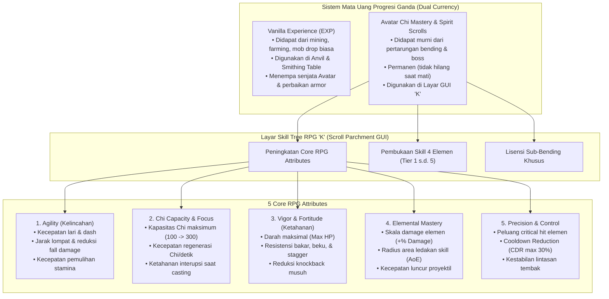
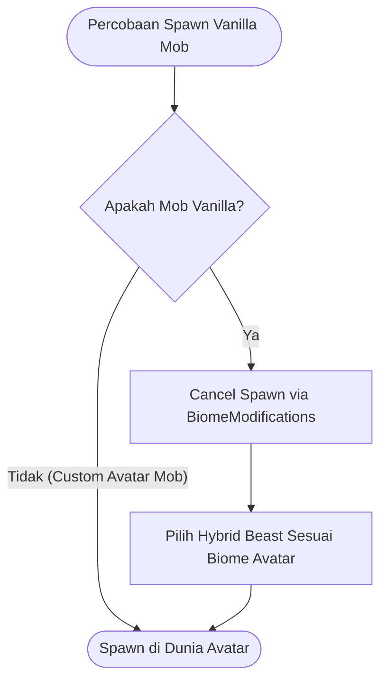
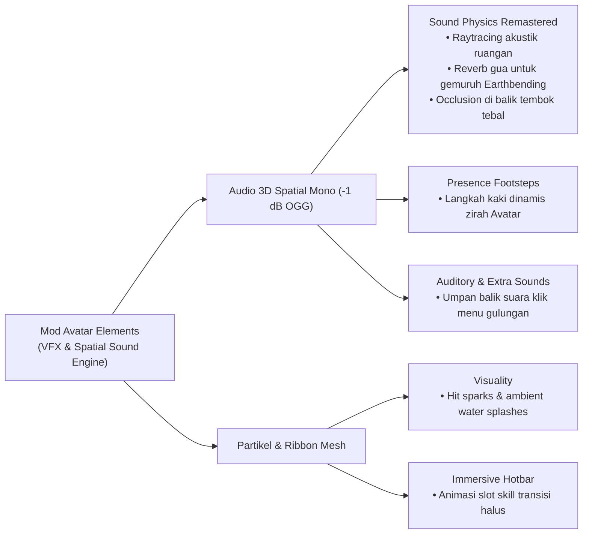

# Master Blueprint & Spesifikasi Aset Avatar: Elements
**Edisi:** Definitif AAA Production Ready, Expansion Catalog & RPG Ecosystem  
**Target Platform:** Minecraft Java Edition 1.21.1 | Fabric Loader | Fabric API (0.115.6+) | Yarn Mappings  
**Instance Host:** Fabulously Optimized (PrismLauncher) + Mod Audio-Visual Open-Source  
**Standar Paket:** Datapack (`pack_format: 48`) | Resource Pack (`pack_format: 34`)  
**VFX & Particle Authoring Skill:** [minecraft-vfx-particle-authoring](file:///d:/repo/Minecraft%20Mod%20&%20Rp/docs/skills/minecraft-vfx-particle-authoring/SKILL.md) (ModMonster, Endesman, KilaBash methodologies)  
**Status Dokumen:** Master Asset, Gameplay & Architecture Living Standard (Untuk AI Agent, Artist Blockbench, & Artist Blender)

---

## 1. Landasan Literatur, Kanon Serial & Filosofi Bela Diri

Seluruh perancangan visual, audio, model 3D, kecerdasan AI, dan sistem progresi dalam mod ini berlandaskan pada kanon resmi *Avatar: The Last Airbender* (ATLA), *The Legend of Korra* (LOK), dokumentasi *Weaponry in the World of Avatar*, serta disiplin seni bela diri tradisional Tiongkok yang dikonsultasikan oleh Sifu Kisu kepada kreator Bryan Konietzko dan Michael Dante DiMartino.

```mermaid
flowchart TD
    subgraph CoreDisciplines["Disiplin Bela Diri Kanonikal & Elemen"]
        Fire["Elemen Api (Firebending)<br>• Northern Shaolin Kung Fu<br>• Agni Kai & Breath of Fire<br>• Kinetik Ekspansif & Linier"]
        Water["Elemen Air (Waterbending)<br>• Yang-style Tai Chi Chuan<br>• Push-and-Pull & Aliran Melingkar<br>• Transmutasi Fase (Cair/Es/Uap)"]
        Earth["Elemen Tanah (Earthbending)<br>• Hung Gar & Southern Mantis<br>• Rooted Stance (Kuda-kuda Rendah)<br>• Percussive Force & Seismic Sense"]
        Air["Elemen Angin (Airbending)<br>• Ba Gua Zhang (Circle Walking)<br>• Rotasi, Defleksi & Evasif<br>• Momentum Dinamis & Non-Lethal"]
    end

    subgraph SubBendings["Cabang Teknik Khusus (Sub-Bending)"]
        Fire --> Lightning["Lightning Generation & Redirection<br>(Cold-Blooded Fire & Yin/Yang Separasi)"]
        Fire --> BlueFire["Blue Fire<br>(Oksidasi Sempurna Azula)"]
        Fire --> Combustion["Combustion Bending<br>(Balistik Balok Chi Dahi)"]
        Water --> Blood["Bloodbending<br>(Manipulasi Fluida Tubuh Tanpa Gore)"]
        Water --> Healing["Healing<br>(Pancaran Chi Biru Lembut)"]
        Water --> Plant["Plantbending<br>(Manipulasi Selulosa Rawa)"]
        Earth --> Metal["Metalbending<br>(Refinemen Serat Baja Ba Sing Se)"]
        Earth --> Lava["Lavabending<br>(Friksi Termodinamika Batuan)"]
        Air --> Flight["True Flight<br>(Kekosongan Bobot Guru Laghima)"]
        Air --> Spiritual["Spiritual Projection<br>(Chi Astral Detachment)"]
    end

    subgraph UltimateState["Puncak Kekuatan Kosmik"]
        Fire & Water & Earth & Air --> AvatarState["Avatar State (Cosmic Chi Conduit)<br>• Orbital 4-Element Rings<br>• Celestial Beacon Ray<br>• Glowing Eyes/Tattoos Layer"]
    end
```



### 1.1 Elemen Api (Firebending) — *Northern Shaolin Kung Fu*
- **Karakteristik Visual & Gerak:** Pukulan dan tendangan linier berjangkauan panjang (*extended strikes*), akrobatik, dan agresif. Api dipicu dari pernapasan diafragma (*dan tian*). Lidah api tajam, menyobek, dengan inti pijar putih (*incandescent core*) dan percikan abu merah-oranye.
- **Sub-Bending:**
  - *Lightning Generation:* Pemisahan energi yin dan yang menjadi listrik dingin (*cold-blooded fire*). Visual: busur listrik biru keunguan bercabang tajam.
  - *Lightning Redirection:* Mengalirkan energi listrik melewati perut tanpa menyentuh jantung.
  - *Blue Fire:* Api bersuhu ultra-tinggi khas Putri Azula dengan pembakaran 100% efisien tanpa residu asap.
  - *Combustion Bending:* Penembakan proyektil balok chi telekinetik dari dahi (*third-eye chakra*) berdaya hancur ledakan masif.

### 1.2 Elemen Air (Waterbending) — *Yang-Style Tai Chi Chuan*
- **Karakteristik Visual & Gerak:** Gerakan melingkar lembut, memanfaatkan kekuatan lawan (*push-and-pull*), dan perubahan fase air yang cepat. Aliran air berupa pita lentur (*fluid mesh ribbon*) yang meruncing di ujung dengan busa putih di titik impak.
- **Sub-Bending:**
  - *Bloodbending:* Pengendalian telekinetik fluida tubuh lawan; visualisasi berupa benang chi merah tipis atau postur kaku tanpa darah berceceran (sesuai rating Minecraft).
  - *Healing:* Aliran air bercahaya cyan-mint melingkari luka untuk restorasi seluler.
  - *Ice Manipulation:* Pembekuan instan menjadi kristal es padat dengan faset tajam dan retakan interior beku.

### 1.3 Elemen Tanah (Earthbending) — *Hung Gar & Southern Praying Mantis*
- **Karakteristik Visual & Gerak:** Kuda-kuda rendah stabil (*sei ping ma*), hentakan kaki berbobot ke tanah (*stomp*), dan pukulan tinju monolitik. Toph Beifong mengadaptasi *Southern Praying Mantis* yang berakar pada sensasi sentuhan kaki untuk mendeteksi getaran tanah (*Seismic Sense*). Visual: batuan bersegi tajam, patahan granit/andesit, semburan debu tebal di titik benturan.
- **Sub-Bending:**
  - *Metalbending:* Manipulasi partikel tanah mikro di dalam logam tempa; visual berupa pita kabel baja pilin mengkilap dan lempengan armor perak.
  - *Lavabending:* Transmutasi batuan padat menjadi magma cair pijar melalui friksi termodinamika tinggi.

### 1.4 Elemen Angin (Airbending) — *Ba Gua Zhang*
- **Karakteristik Visual & Gerak:** Langkah melingkar (*circle walking*), gerakan tubuh memutar, defleksi proyektil, dan momentum non-lethal yang membingungkan lawan. Visual: pita hembusan angin semi-transparan, cincin gelombang kejut kompresi udara, dan corong tornado berputar.
- **Sub-Bending:**
  - *True Flight:* Pelepasan total dari ikatan duniawi (*Guru Laghima & Zaheer*); melayang bebas 3D tanpa sayap dengan distorsi udara lembut.
  - *Air Suffocation:* Kubah hampa udara berputar lambat di sekeliling kepala lawan dengan opasitas rendah.

---

## 2. Standar Teknis & Batasan Arsitektur Minecraft 1.21.1

Setiap aset dan kode wajib mematuhi aturan baku platform **Minecraft Java 1.21.1 Fabric Loader**:

```
+---------------------------------------------------------------------------------------------------+
|                                 GUARDRAILS MUTLAK MINECRAFT 1.21.1                                |
+---------------------------------------------------------------------------------------------------+
| 1. DILARANG menggunakan komponen 1.21.2+ / 1.21.4+ ('minecraft:equippable' & 'minecraft:item_model')|
|    Komponen tersebut menyebabkan client 1.21.1 CRASH atau gagal membaca model JSON.              |
| 2. WAJIB menggunakan native component 1.21.1:                                                     |
|    - 'minecraft:custom_data'                                                                      |
|    - 'minecraft:custom_model_data' (Formula 4 Digit NTPP)                                         |
|    - 'minecraft:trim' ('material' & 'pattern')                                                    |
|    - 'minecraft:attribute_modifiers'                                                              |
|    - 'minecraft:item_name' & 'minecraft:lore'                                                     |
| 3. Datapack 'pack_format' = 48 | Resource Pack 'pack_format' = 34                                  |
| 4. Titik Origin Model (0.0, 0.0, 0.0) WAJIB berada di titik genggaman tangan (Hand Grip Pivot).   |
| 5. Koordinat Java Model setelah translasi +8.0 WAJIB berada strictly di [-16.0, 32.0].           |
| 6. Rotasi Java Model strictly dibatasi pada sudut legal vanilla: [-45°, -22.5°, 0°, 22.5°, 45°].  |
+---------------------------------------------------------------------------------------------------+
```

### 2.1 Matriks Resolusi & Format Aset AAA

| Kategori Aset | Format File | Resolusi / Dimensi | Channel / Color Space | Keterangan Standar & Konvensi Naming |
| :--- | :--- | :--- | :--- | :--- |
| **GUI Skill / Item Icon** | `.png` | 32×32 px (HD Pixel Art) | RGBA, sRGB | Outline kontras 1px, latar transparan, `icon_<name>.png` |
| **Status Effect Icon** | `.png` | 18×18 px | RGBA, sRGB | Standar mob effect vanilla Fabric, `textures/mob_effect/` |
| **Wearable Armor Texture** | `.png` | 64×32 px (Layer 1 & 2) | RGBA, sRGB | UV mapping Steve/Alex biped, kompatibel Trim 1.21.1 |
| **Weapon 3D Model (Java)** | `.json` | Cuboid mesh | Box UV / Per-face | Offset $+8.0$ unit, bounds $[-16.0, 32.0]$, locator trails |
| **Weapon Project (Source)** | `.bbmodel` | Blockbench 4.10+ | Box UV 64×64 Atlas | Format sumber utama untuk seluruh senjata dan armor |
| **Weapon Texture Atlas** | `.png` | 64×64 px cel-shaded | RGBA, sRGB | 4 kuadran UV terstruktur (Bilah, Fitting, Grip, Hiasan) |
| **Mob / Boss Model** | `.geo.json` | Bedrock Entity format | Hierarchical bones | Kompatibel Fabric GeckoLib / Fabric Animator |
| **Mob Texture Skin** | `.png` | 128×128 px | RGBA, sRGB | Termasuk file terpisah `_glow.png` untuk layer emissive |
| **Micro-Particle Sprite** | `.png` | 16×16 px per frame | RGBA, Unpremultiplied | Frame terpisah `_0.png`, `_1.png` untuk `SpriteProvider` |
| **VFX Ribbon / Mesh** | `.png` + `.obj` | 128×32 px strip | RGBA, sRGB | UV scrolled horizontal, seamless repeat |
| **Sound Effects (SFX)** | `.ogg` | 44.1 kHz, 16-bit Mono | Vorbis, norm -1 dB | Format MONO mutlak untuk 3D spatial attenuation in-game |

---

## 3. Sistem RPG Core Attributes & Dual-Progression Skill Tree

Mod mengintegrasikan **Sistem RPG Mandiri (*Standalone Native RPG System*)** tanpa mewajibkan dependensi mod eksternal yang rapuh, namun tetap dirancang kompatibel jika pengguna memasang mod RPG komunitas Fabric 1.21.1 seperti *Pufferfish's Skills*, *LevelZ*, atau *Passive Skill Tree*.



### 3.1 Spesifikasi 5 Core RPG Attributes

| Attribute ID | Nama Atribut | Nilai Awal | Batas Maksimum | Efek per Poin Investasi | Formula Modifikasi Atribut |
| :--- | :--- | :--- | :--- | :--- | :--- |
| `avatar:agility` | **Agility (Kelincahan)** | `0` | `50` | $+1.5\%$ Movement Speed, $+2\%$ Jarak Dash, $+1.2\%$ Attack Speed, $-1.5\%$ Stamina Cost | `attributes.GENERIC_MOVEMENT_SPEED` |
| `avatar:chi_focus` | **Chi Focus (Kapasitas & Aliran)**| `100` | `300` | $+4$ Max Chi, $+0.15$ Chi Regen/detik, $-0.8\%$ Biaya Chi per jurus | `PlayerBendingData.maxChi` & `chiRegenRate` |
| `avatar:vigor` | **Vigor (Vitalitas & Ketahanan)** | `20` | `60` | $+0.8$ Max HP, $+1.5\%$ Resistensi Elemental Burn/Chilled, $+1\%$ Stagger Recovery | `attributes.GENERIC_MAX_HEALTH` |
| `avatar:mastery` | **Elemental Mastery** | `0` | `50` | $+1.8\%$ Bending Damage, $+1\%$ AoE Radius, $+1.5\%$ Proyektil Velocity | `SkillValidator.damageMultiplier` |
| `avatar:precision`| **Precision (Kontrol & Fokus)** | `0` | `40` | $+0.75\%$ Crit Chance ($1.5\times$ damage), $+0.6\%$ Cooldown Reduction (Max $30\%$) | `SkillTimeline.cooldownTicks` |

### 3.2 Analisis Kompatibilitas Mod Eksternal vs Sistem Mandiri
- **Jika Berdiri Sendiri (*Standalone - Rekomendasi Utama*):** Seluruh atribut disimpan di NBT pemain (`PlayerBendingData.java`) dan ditampilkan di layar kustom bertema perkamen suku air/api saat menekan tombol **`[K]`**. Bebas konflik mod.
- **Jika Disandingkan dengan Mod Eksternal:**
  - *LevelZ / PlayerEx:* Menggunakan bridge Fabric Event untuk memetakan `player.getAttributeInstance(EntityAttributes.GENERIC_MOVEMENT_SPEED)` agar tersinkronisasi dua arah.
  - *Pufferfish's Skills:* Menyediakan file datapack opsional `data/avatar/skills/pufferfish_avatar_tree.json` jika mod tersebut terdeteksi di classpath `FabricLoader.getInstance().isModLoaded("puffish_skills")`.

---

## 4. Ensiklopedi Bestiary Lengkap (42 Custom Mobs, Pets & Mounts)

Untuk menciptakan dunia Avatar yang otentik dan imersif, seluruh ekosistem makhluk hidup diatur melalui sistem **Wipeout & Natural Replacement** yang mencegat spawning vanilla dan menggantikannya dengan fauna hibrida Avatar:



### 4.1 Pemetaan Wipeout & Penggantian Mob Vanilla

| Vanilla Mob | Pengganti Fauna Avatar (Hybrid Beast) | Tipe & Perilaku | Biome Habitat |
| :--- | :--- | :--- | :--- |
| **Zombie & Husk** | **Fire Nation Scout / Bandit** | Hostile Humanoid Melee/Fire | Savanna, Desert, Badlands |
| **Skeleton & Stray** | **Dai Li Agent / Earth Rogue** | Hostile Ranged Earth Gauntlet | Caves, Mountains, Deepslate |
| **Creeper** | **Shirshu / Canyon Crawler** | Hostile Ambush (Pelacak aroma/racun) | Dark Forest, Badlands, Canyons |
| **Spider / Cave Spider** | **Canyon Crawler / Giant Beetle** | Hostile Arthropod (Merayap di tebing) | Desert, Canyons, Underground |
| **Enderman** | **Dark Spirit / Wan Shi Tong's Fox** | Neutral Eerie (Teleportasi Roh) | Spirit Oases, Night Plains, End |
| **Pig & Cow** | **Flying Bison (Wild) / Ostrich Horse** | Passive Herd (Susu, daging, kulit) | Plains, Meadow, Savanna |
| **Sheep** | **Koala Sheep** | Passive (Menghasilkan wol koala lembut) | Forest, Taiga, Windswept Hills |
| **Chicken** | **Turtle Duck** | Passive Aquatic (Berenang, bertelur) | River, Swamp, Warm Ocean |
| **Wolf / Dog** | **Polar Bear Dog / Dingo Dog** | Tameable Combat Companion | Snowy Plains, Frozen Tundra |
| **Cat / Ocelot** | **Winged Lemur** | Tameable Shoulder Companion | Jungle, Windswept Forest, Temple |

### 4.2 Katalog 42 Custom Mobs Avatar Dunia

#### A. Fauna Herbivora, Ternak & Satwa Liar (10 Mobs)
1. **Flying Bison (Wild):** Bison raksasa 6 kaki bertanduk, penghasil susu dan bulu lebat (Plains, Mountains).
2. **Ostrich Horse:** Kuda berkaki burung unta berparuh, tunggangan darat cepat dan lincah (Plains, Savanna).
3. **Koala Sheep:** Domba bulat berwajah koala, menghasilkan wol sutra lembut (Forests, Taiga).
4. **Turtle Duck:** Bebek hijau bercangkang kura-kura, berenang di kolam dan danau (Rivers, Swamps).
5. **Rabbi-Roo:** Kelinci pelompat berkantong kanguru (Plains, Badlands).
6. **Tigerdillo:** Harimau bertempurung lempeng keras yang menggulung diri saat terancam (Jungle, Savanna).
7. **Platypus Bear:** Beruang bertungkai cakar dengan moncong bebek (Taiga, Old Growth Pine).
8. **Otter Penguin:** Penguin besar berbulu berang-berang yang dapat diselancari di atas es (Snowy Plains).
9. **Boar-q-pine:** Babi hutan bertaring tajam berbulu duri landak yang dapat ditembakkan (Dark Forest).
10. **Hog Monkey:** Kera gempal berhidung babi yang memetik dan melempar buah liar di tajuk pohon (Jungles).

#### B. Companion Pets & Mounts Khusus (6 Mobs)
11. **Sky Bison Companion (Appa Breed):** Mount terbang kolosal 6-penumpang. Kendali 3D bebas (*Yip-Yip!*), kibasan ekor penepis angin (*Tail Blast*), dan kapasitas inventori pelana 54-slot. Dijinakkan dengan *Nomad Hay Pellet*.
12. **Winged Lemur (Momo Breed):** Companion pundak (*shoulder perch*). Mengambilkan item drop dari kejauhan dan memberikan efek *Slow Falling II* saat pemain terjatuh. Dijinakkan dengan *Moon Peach*.
13. **Polar Bear Dog (Naga Breed):** Mount tempur arktik perkasa. Meluncur $2.2\times$ di atas salju/es, gigitan maul mematikan (14 HP + stagger), dan auman *Roar of the Tundra* (Weakness & Slowness AoE). Dijinakkan dengan *Raw Salmon*.
14. **Messenger Hawk:** Burung pengantar surat antar koordinat pemain di server. Dijinakkan dengan *Dried Meat*.
15. **Fire Ferret (Pabu Breed):** Pet mungil lincah pengalih perhatian musuh dan pemotong jebakan tali.
16. **Komodo Rhino:** Mount badak berzirah berat Fire Nation yang mampu menerjang dan meremukkan pintu kayu.

#### C. Predator Liar & Monster Rimba (8 Mobs)
17. **Shirshu:** Monster pelacak buta dengan ribuan sungut penciuman tajam dan lidah cemeti paralis racun.
18. **Canyon Crawler:** Laba-laba kepala buaya berkulit duri perayap tebing vertikal penyembur asam lambung.
19. **Catgator:** Aligator berkumis lele penyergap dari rawa keruh berlumpur.
20. **Wolfbat:** Kelelawar kepala serigala penghuni gua dalam berdaya serang lolongan ultrasonik.
21. **Saber-tooth Moose Lion:** Singa bertaring panjang dan bertanduk moose berdaya seruduk 8 blok.
22. **Sand Shark:** Hiu pasir penjelajah bawah tanah gurun dengan pusaran jebakan pasir hisap.
23. **Giant Buzzard Wasp:** Tawon bangkai raksasa bersarang di tebing mesa bersengat lemas penurun stamina.
24. **Eel Hound:** Reptil amfibi bertubuh panjang pelari darat dan perenang kilat di sepanjang garis pantai.

#### D. Fraksi Humanoid Bender & Non-Bender (8 Mobs)
25. **Fire Nation Spearman / Archer:** Prajurit infanteri penombak api dan pemanah panah pijar.
26. **Fire Nation Firebender:** Pasukan tempur pelontar Fire Jab, Flame Sweep, dan Fire Blast.
27. **Dai Li Agent:** Agen rahasia bersarung tangan batu, berseluncur di atas tanah dan pembuat dinding jebakan.
28. **Earth Empire Soldier:** Prajurit lapis baja bersenjatakan cambuk kabel baja dan tameng logam antiproyektil.
29. **Equalist Chi Blocker:** Non-bender akrobatik; pukulan titik saraf (*Chi Blocking*) mematikan skill bender pemain selama 6 detik!
30. **Equalist Electro-Brawler:** Pasukan sarung tangan listrik tegangan tinggi penembus zirah besi.
31. **Rough Rhinos Bandit:** Bandit berkuda Komodo penunggang bom asap dan kapak berputar.
32. **Swamp Waterbender:** Pengendali tanaman rawa berkabut pembuat jerat sulur membelit.

#### E. Roh Penjaga & Spirit World (5 Mobs)
33. **Knowledge Fox (Wan Shi Tong):** Rubah cerdas pembimbing ke reruntuhan kuno, drop manuskrip chi.
34. **Dark Shadow Spirit:** Roh bayangan bertanduk perusak chi (*Chi Drain*) yang agresif di malam hari.
35. **Light Meadow Spirit:** Roh kijang pastel pemulih HP dan Chi di sekitar Spirit Oasis suci.
36. **Dragonfly Spirit:** Capung raksasa bercahaya penyeberang gerbang antar dimensi roh.
37. **Koh's Face-Stolen Minion:** Humanoid merayap tanpa wajah di lapisan deepslate; menyerang jika kursor bergerak mendadak.

#### F. Mini-Bosses & Prime World Bosses (5 Bosses)
38. **Combustion Man:** Mini-boss regional penembak laser dahi berdaya ledak 80 blok.
39. **General Fong:** Komandan perang bumi pencipta lubang pasir hisap dan golem batu pengawal.
40. **Hama the Puppetmaster:** Nenek sihir pengendali darah di bawah sinar bulan purnama (*Bloodbending Trial*).
41. **Prime Boss 1: Phoenix King Ozai (Sozin's Comet Form):** Pengganti Ender Dragon (1000 HP, 3 Fase).
42. **Prime Boss 2: Vaatu, The Spirit of Chaos & Darkness:** Pengganti Wither (1200 HP, 8 Tentakel Bayangan).

---

## 5. Roaming Sub-Bosses, Multi-Stage Mob Leveling & Tactical AI

### 5.1 Lima Roaming Sub-Bosses (Bos Pengelana Liar)
Sub-boss berpatroli secara dinamis di bioma terbuka tanpa arena statis:

| Roaming Sub-Boss | Karakteristik & Visual | Wilayah Jelajah (Biome) | Kemampuan AI & Perilaku Unik | Hadiah Drop Legendaris |
| :--- | :--- | :--- | :--- | :--- |
| **June & Nyla the Shirshu** | Pemburu bayaran menunggangi Shirshu | Dark Forest, Plains, Savanna | **Scent Hunting AI**: Melacak pemain dari jarak 96 blok, cambuk racun paralis, Shirshu menerkam | *Shirshu Toxin Whip*, *Beastmaster Saddle* |
| **The Boulder (Champion)** | Pegulat tanah bertubuh kekar raksasa | Badlands, Mountain Peaks | **Earthquake Slams**: Hentakan tanah memicu retakan radial, lemparan batu megalith 2 ton | *Champion's Earth Belt*, *Heavy Boulder Shard* |
| **Pirate Captain & Iguana** | Kapten perompak tangan kait & burung reptil| Coastlines, River Deltas | **Water Cutlass Whirlwind**: Pedang pusaran air berputar, tembakan jaring pengikat pemain | *Smuggler Stash*, *Net Launcher* |
| **Desert Beetle Behemoth**| Kumbang lapis baja gurun bertanduk bor ganda | Desert Dunes, Temples | **Burrowing Ambush**: Menyelam di pasir, menyembul di bawah kaki, semburan asam belerang | *Chitin Carapace Plate* (Bahan Zirah Kuat) |
| **Hei Bai (Corrupted Spirit)**| Monster berkaki enam hitam bertaring merah | Taiga, Ancient Forests | **Dimensional Phase**: Menembus pohon, tembakan sonik pemusnah blok (*Sonic Forest Beam*) | *Purified Spirit Acorn* (Kunci Portal Roh) |

### 5.2 Sistem Multi-Stage Leveling & Mutasi Visual Mobs (Tier 1 s.d. 5)
Setiap mob memiliki tingkatan level 1–5 berdasarkan jarak dari titik awal dunia (*distance scaling*):

```
[Tier 1: Recruit/Scavenger] ──► [Tier 2: Veteran/Hunter] ──► [Tier 3: Elite/Alpha] ──► [Tier 4: Master/Behemoth] ──► [Tier 5: Mythic Ascendant]
```

- **Tier 1 (Recruit):** Skala $0.85\times$, pakaian kain biasa, melempar 1 Fire Jab, mundur jika HP $<20\%$.
- **Tier 2 (Veteran):** Skala $1.0\times$, mengenakan helm baja dan pelindung dada, kombo Flame Sweep melingkar.
- **Tier 3 (Elite Officer / Alpha):** Skala $1.3\times$, jubah merah menyala, pedang berapi ganda, dash Fire Jet mendekat dan Fire Blast.
- **Tier 4 (Master / Behemoth):** Skala $1.6\times$, api berubah menjadi oranye-kebiruan pekat, aura panas memancarkan partikel abu, tangkisan Fire Guard, langkah kaki mengguncang layar (*Screenshake 0.2*).
- **Tier 5 (Mythic Ascendant / Primal):** Skala $2.0\times$, **Api Biru Murni (Azula Fire)** atau kilatan petir instan, tubuh bertatahkan kristal lava/es, mini-boss bar khusus, kebal terhadap stun biasa.

### 5.3 Arsitektur Kecerdasan Buatan Taktis (*Behavior Tree Goal AI*)
1. **Flanking & Pincer Maneuvers:** Dua prajurit memutar ke kiri dan kanan untuk mengepung sementara penembak jarak jauh menembak dari tengah.
2. **Kiting & Distance Keeping:** Bender proyektil dan pemanah otomatis melompat mundur (*back-step*) sejauh 4 blok jika pemain mendekat membawa senjata melee berat.
3. **Counter-Bending Reactions:** Earthbender otomatis mencuatkan pilar/dinding batu saat mendeteksi proyektil datang; Firebender Tier 4+ membelah proyektil air/api dengan tebasan tebas.
4. **Morale & Tactical Retreat:** Jika komandan skuad atau Alpha Beast terbunuh, prajurit Tier 1–2 mengalami kepanikan (*Demoralized*) dan melempar bom asap untuk melarikan diri.

---

## 6. Prime World Bosses (Pengganti Ender Dragon & Wither)

### 6.1 Prime Boss 1: Phoenix King Ozai (Sozin's Comet Form) — [Pengganti Ender Dragon]
- **Arena:** *Wulong Forest / Sozin's Battlefield* (Dimensi End Island yang dirombak total menjadi pilar-pilar batu megah).
- **Health Pool:** `1000 HP` (Boss Bar Merah Menyala).
- **Mekanisme 3 Fase Pertarungan:**
  - **Fase 1 (Aerial Fire Thruster):** Melayang bebas di angkasa menggunakan propulsi api ganda dari kedua kaki, menghujani meteor api dan semburan *Sozin Flamethrower*.
  - **Fase 2 (Instant Dual Lightning):** Mendarat di puncak pilar batu, mengisi dua kilatan petir mematikan di kedua tangan (wajib ditangkis dengan *Lightning Redirection* atau perisai tanah tebal).
  - **Fase 3 (Cataclysmic Flame Shield):** Bola api pelindung berputar 360° yang membakar proyektil; pemain wajib memasuki Avatar State untuk meremukkan pelindung tersebut.
- **Hadiah Drop:** *Crown of the Fire Lord*, *Essence of the Dragon*, dan *Scroll of True Lightning*.

### 6.2 Prime Boss 2: Vaatu, The Spirit of Chaos & Darkness — [Pengganti Wither]
- **Pemanggilan:** Meletakkan 3 *Corrupted Spirit Relics* pada altar *Harmonic Convergence*.
- **Health Pool:** `1200 HP` (Boss Bar Ungu Gelap).
- **Mekanisme Pertarungan:**
  - **Spirit Tendril Crush:** 8 tentakel bayangan raksasa mencuat dari tanah mengunci pergerakan pemain.
  - **Purple Energy Cannon:** Sinar laser kosmik ungu lurus berjarak 60 blok yang memicu efek *Chi Severance* (membungkam seluruh skill bending selama 10 detik).
- **Hadiah Drop:** *Dark Avatar Core* (Bahan pembuat jubah kegelapan dan unifikasi roh).

---

## 7. Katalog 16 Senjata Kanonikal Avatar Suite

```
+---------------------------------------------------------------------------------------------------+
|                                 ATLAS KUADRAN TEKSTUR 64x64 CEL-SHADED                            |
+---------------------------------------------------------------------------------------------------+
| Quadrant 0 [UV: 0..32, 0..32]                  | Quadrant 1 [UV: 32..64, 0..32]                   |
| Permukaan Utama: Bilah Baja / Monolit Basal /   | Fitting Logam: Guard Kuningan, Sabuk Besi Tempa, |
| Tulang Paus Kutub / Es Abadi Gletser           | Paku Keling, Lis Emas Imperial                   |
+------------------------------------------------+--------------------------------------------------+
| Quadrant 2 [UV: 0..32, 32..64]                 | Quadrant 3 [UV: 32..64, 32..64]                  |
| Pegangan & Bahan Organik: Lilitan Tali Merah,  | Aksesori & Ornamen: Rumbai Sutra Merah, Manik    |
| Kulit Pelana Cokelat, Kayu Apung Arktik        | Giok Ba Sing Se, Sarung Rosewood, Ekor Ikan      |
+---------------------------------------------------------------------------------------------------+
```

### 7.1 Empat Senjata Kanonikal Utama (Core ATLA Weapons)
1. **`SM_Dual_Swords` (Zuko Dao Broadswords / Shuang Dao):**
   - Dimensi: $7.4 \times 33.0 \times 7.7$ unit ($1.94\text{ m}$). Grip Pivot: $(0, 0, 0)$. Bounds Java: $Y \in [-1.2, +31.8]$. Guard setengah lingkaran asimetris yang rata di sisi dalam agar sepasang pedang masuk rapi ke dalam satu sarung rosewood.
2. **`SM_Earth_Hammer` (Kyoshi / Gow Warhammer):**
   - Dimensi: $13.6 \times 37.4 \times 8.2$ unit ($2.34\text{ m}$). Grip Pivot: $(0, 0, 0)$. Bounds Java: $Y \in [-6.2, +31.2]$. Kepala palu monolitik basal hitam bertatah urat kristal giok Ba Sing Se dengan sabuk besi tempa dan paku keling baja.
3. **`SM_War_Fan` (Kyoshi Warriors War Fan / Shanzi):**
   - Dimensi: $20.0 \times 21.9 \times 1.6$ unit ($1.37\text{ m}$). Dual-state (terbuka & tertutup). Rusuk luar bilah baja tebal tajam untuk *Fan Parry*, daun sutra hijau zamrud berlis emas imperial.
4. **`SM_Water_Spear` (Water Tribe Harpoon Spear):**
   - Dimensi: $5.0 \times 38.6 \times 2.2$ unit ($2.41\text{ m}$). Mata tombak tulang paus kutub berinti es abadi gletser cyan, dua kait harpun (*barbed toggles*), batang kayu apung arktik dengan lilitan kulit anjing laut biru nila.
5. **`SM_Air_Staff` & Glider (Tongkat Glider Pengembara Udara):**
   - Dual-state (`air_staff.json` posisi jalan dan `air_staff_glider.bbmodel` sayap terbuka saat terbang).

### 7.2 Sebelas Senjata Tambahan ATLA/LOK yang Terkurasi
6. `weapon_meteorite_space_sword.bbmodel`: Pedang meteorit hitam legendaris tempaan Sokka dan Master Piandao.
7. `weapon_piandao_steel_jian.bbmodel`: Pedang lurus bangsawan Fire Nation bermata ganda dengan pommel lotus putih.
8. `weapon_sokka_boomerang.bbmodel`: Bumerang kayu bertakik dengan bilah baja melengkung luar.
9. `weapon_jet_hook_swords.bbmodel`: Sepasang pedang berkait (*Shuang Gou*) pejuang kebebasan Jet.
10. `weapon_daili_rock_glove.bbmodel`: Sarung tangan batu granit agen Dai Li.
11. `weapon_equalist_electrified_glove.bbmodel`: Sarung tangan tembaga steampunk bertenaga baterai kawat Tesla Amon.
12. `weapon_water_wolf_club.bbmodel`: Pentungan kayu kepala serigala bermahkota taji gigi tulang.
13. `weapon_water_jaw_blade.bbmodel`: Belati bergerigi tajam dari rahang hiu kutub.
14. `weapon_lieutenant_kali_sticks.bbmodel`: Sepasang tongkat tempur eskrima listrik letnan Equalist.
15. `weapon_mai_stiletto_darts.bbmodel`: Jarum lempar stiletto pegas tersembunyi Mai.
16. `weapon_kyoshi_wrist_shield.bbmodel`: Perisai bundar kecil baja hijau di pergelangan tangan Prajurit Kyoshi.

---

## 8. Sistem Armor 28 Set (112 Pieces) 7-Tier Elemental Progression

Setiap komponen armor mematuhi aturan kesetaraan elemen mutlak (*Elemental Parity*) dengan formula Custom Model Data (CMD) 4 digit baku:
$$\text{CMD} = N \times 1000 + T \times 100 + PP$$
- $N$ (Nation): `1` = Fire, `2` = Water, `3` = Earth, `4` = Air.
- $T$ (Tier): `1` = Initiate, `2` = Apprentice, `3` = Adept, `4` = Veteran, `5` = Master, `6` = Mythic, `7` = Sovereign (Godplate).
- $PP$ (Piece): `01` = Helmet, `02` = Chestplate, `03` = Leggings, `04` = Boots.

| Tier | Base Armor Vanilla | Fire Nation Trim | Water Tribe Trim | Earth Kingdom Trim | Air Nomad Trim |
| :--- | :--- | :--- | :--- | :--- | :--- |
| **I: Initiate** | Leather | `redstone` / `sentry` | `lapis` / `coast` | `emerald` / `coast` | `gold` / `coast` |
| **II: Apprentice** | Chainmail | `copper` / `dune` | `lapis` / `dune` | `emerald` / `dune` | `gold` / `dune` |
| **III: Adept** | Iron | `redstone` / `wild` | `diamond` / `wild` | `emerald` / `wild` | `copper` / `wild` |
| **IV: Veteran** | Iron (Reinforced) | `netherite` / `host` | `lapis` / `host` | `iron` / `host` | `gold` / `host` |
| **V: Master** | Diamond | `redstone` / `vex` | `lapis` / `vex` | `emerald` / `eye` | `gold` / `vex` |
| **VI: Mythic** | Netherite | `gold` / `spire` | `diamond` / `spire` | `emerald` / `spire` | `amethyst` / `spire` |
| **VII: Sovereign**| Netherite (Godplate) | `redstone` / `silence` | `lapis` / `silence` | `emerald` / `silence` | `gold` / `silence` |

---

## 9. Sinergi Audio-Visual Open-Source (Instance Fabulously Optimized)

Mod didesain untuk bersinergi sempurna dengan racikan mod audio-visual open-source legal bebas DRM yang telah terpasang di instance **Fabulously Optimized** (`MOD_LIST_RACIKAN.md`):



1. **Akustik Spasial (*Sound Physics Remastered*):** Suara dentuman *Earth Hammer* atau gemuruh *Earth Boulder* secara otomatis direverb fisik di dalam gua atau lembah ngarai.
2. **Ambient Particle Synergy (*Visuality*):** Percikan api dan busa air Avatar berpadu serasi dengan partikel ambient vanilla tanpa konflik shader Sodium/Iris.
3. **Umpan Balik Menu (*Extra Sounds & Immersive Hotbar*):** Membuka gulungan perkamen GUI `[K]` dan menavigasi pohon skill memberikan sensasi audio klik taktil responsif.

---

## 10. Panduan Kurasi Folder `art-source/` & Bridge Integrasi Agent

Folder `art-source/` ditata dengan struktur taksonomi yang ketat untuk memudahkan **Coding Agent (Claude Code / Fabric Java)**, **Blockbench Artists**, dan **Blender Artists**:

```
d:\repo\Minecraft Mod & Rp\art-source\
├── README.md                          # Panduan umum dan ringkasan struktur
├── CURATION_MANIFEST.md               # Tabel pemetaan aset art-source -> target runtime mod
├── asset_pack/                        # ASET MASTER KANONIKAL
│   ├── models/                        # Model Java .json & Bedrock .geo.json
│   │   └── bbmodel/                   # Sumber proyek Blockbench 4.10 (.bbmodel)
│   │       ├── weapons/               # 16 Senjata kanonikal lengkap
│   │       └── armor/                 # 7 Model armor 3D khusus
│   └── animation/                     # Klip animasi rig pemain PAL
├── asset_pack_t2_vfx/                 # ASET MASTER T2 VOLUMETRIC VFX
│   └── assets/avatar_elements/        # Partikel JSON, frame PNG, ikon GUI, mob effect
├── models/                            # MODEL STAGING PRODUKSI
│   ├── air_staff/                     # Sumber, preview, dan handoff Claude Air Staff
│   └── avatar_skills/                 # Script Blender builder & aset skill 3D
├── animation_studies/                 # STUDI RIG & MOTION STUDY
│   ├── fire_jab/                      # Keyframe data, storyboard, motion GIF Fire Jab
│   └── staff_thrust/                  # Studi gerak tusukan tongkat pengembara udara
├── audio/                             # SOUND EFFECTS SPATIAL
│   ├── candidates/                    # Sampel audio master WAV/OGG
│   └── prototype/                     # Audio prototipe terintegrasi
├── ui/                                # ANTARMUKA PENGGUNA (GUI & HUD)
│   └── concepts/                      # Mockup disetujui (Water Tribe UI Overlook.png)
├── tools/                             # TOOLING & VERIFIKASI
│   ├── blockbench_interactive/        # Test runner JS & script otomasi Blockbench
│   └── verify_assets.py               # Script audit aset otomatis
├── scratch_asset_expert/              # SCRATCHPAD & PROTOTYPING
│   └── (File eksperimental Air Staff Glider & FireJabRenderer)
└── archive/                           # ARSIP HISTORIS & CADANGAN ZIP MASTER
```

---

## 11. Daftar Verifikasi Kualitas Produksi (QA Acceptance Checklist)

Sebelum aset dinyatakan **Production Ready (AAA Grade)**:

- [ ] **Bounds Validation:** Seluruh model Java `.json` berada strictly di $[-16.0, 32.0]$ setelah translasi $+8.0$.
- [ ] **Pivot Check:** Origin $(0, 0, 0)$ model berada persis di titik genggaman tangan pemain (*grip point*).
- [ ] **Angle Legality:** Tidak ada sudut rotasi selain $-45^\circ, -22.5^\circ, 0^\circ, +22.5^\circ, +45^\circ$ pada model Java.
- [ ] **Atlas Coherence:** Tekstur senjata mematuhi 4 kuadran UV 64×64 tanpa pixel bleeding atau overlapping antar kuadran.
- [ ] **Particle Age Stepping:** Partikel client berganti frame seiring usia (*age*) dan memiliki batas hidup terdefinisi (*maxAge*).
- [ ] **Tick Budget Compliance:** Partikel idle tidak melebihi 2–5 partikel/detik per pemain untuk menjamin kelestarian TPS server.
- [ ] **Audio Spatialization:** Seluruh SFX berformat Mono OGG 44.1 kHz dengan normalisasi $-1\text{ dB}$ untuk memastikan atenuasi 3D in-game berfungsi akurat.
- [ ] **Elemental Parity:** Nilai pertahanan dan ceiling tier keempat elemen setara tanpa bias pada elemen tertentu.
- [ ] **Mob Wipeout Interception:** 100% spawning monster vanilla tergantikan dengan mulus oleh fauna hibrida Avatar melalui `BiomeModifications`.
- [ ] **RPG Attribute Stability:** Nilai atribut Agility, Chi, Vigor, Mastery, dan Precision tersimpan aman di NBT tanpa duplikasi atau reset saat respawn.
