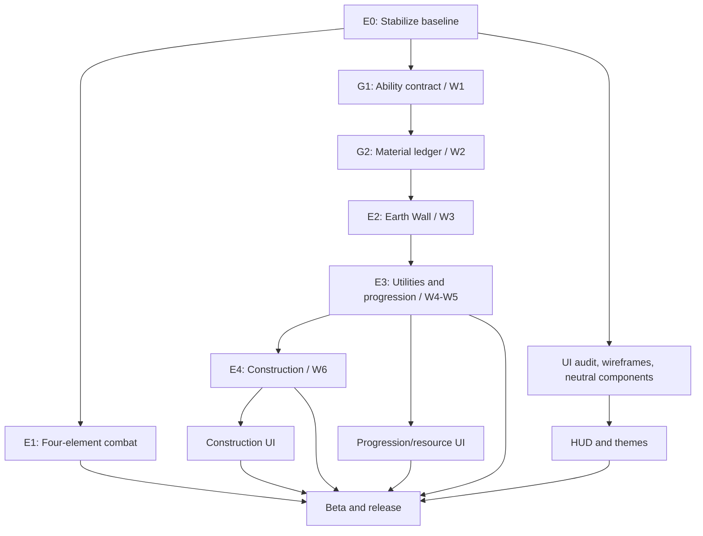

# Avatar: Elements — Roadmap Project Plan

Status: Draft plan, based on repository documentation reviewed 2026-11-09.  
Target: Minecraft Java 1.21.1, Fabric; singleplayer and dedicated-server play.  
Planning rule: this plan organizes work; it does not change implementation status in `docs/TASKS.md`.

## 1. Project Overview

### Goal

Deliver a readable, responsive Avatar-inspired combat mod whose server-authoritative
abilities, animations, hit detection, visual effects, audio, and progression behave as
one coherent gameplay timeline. Expand from the existing vertical slice through
four-element combat, safe world interaction, optional progression, a scroll-themed UI,
and release validation.

### User value

- Players can understand and use elemental abilities reliably in singleplayer and multiplayer.
- Each element has a distinct combat identity without requiring a separate implementation
  for every catalog entry.
- World-changing abilities conserve materials, respect server permissions, and recover
  safely from interruption or restart.
- The UI presents useful state without obscuring combat or pretending unavailable server
  data is live.

### Success criteria

1. The multiplayer baseline passes two-player dedicated-server tests for independent
   chi/cooldowns, correct ability ownership, and synchronized effects.
2. Every ability exposed as usable has a validated definition, a server-authoritative
   handler, and explicit tests for its supported cast lifecycle.
3. World mutations pass conservation, rollback, persistence, permission, and contention
   tests before terrain-changing content is enabled.
4. UI preferences and HUD state are readable at supported GUI scales, keyboard-operable,
   and do not leak input into combat.
5. A clean client/server installation and upgrade path pass documented release checks.

Metrics and numeric performance budgets must be baselined and approved before the relevant
performance issue is started; this plan does not invent targets absent from project docs.

### Verified planning inputs

- `docs/TASKS.md` distinguishes build success from runtime verification. It records
  multiplayer synchronization as pending, Air Palm/Air Blast verification as pending,
  and several built features as not yet tested.
- The same task list records charge orb and Fire Blast work as implemented/build-verified,
  with additional lifecycle and visual verification still needed.
- `docs/CONTENT_SPEC.md` identifies the bundled skill JSON as runtime data, documents
  schema gaps (`CHANNEL`, `TOGGLE`, `chiPerTick`), and distinguishes the 11 listed active
  skill definitions from the larger design catalog.
- `docs/PROJECT_PLAN.md` establishes the W1–W7 world/content roadmap and a separate UI path.
- `docs/UI_THEME_SPEC.md`, `docs/ASSET_PRODUCTION_SPEC.md`, and `docs/COMBAT_CONTRACT.md`
  provide design and quality constraints.
- `docs/TASKS.md` is the project status source. Any status must be refreshed from the
  current code, build, and test evidence when an issue is created or accepted.

### Out of scope for this plan

- Creating GitHub issues, milestones, labels, or project-board automation. The checklist
  is a local preparation artifact only.
- Treating every entry in the 62-skill catalog as a release commitment.
- Adding MythicMobs, ModelEngine, RP Engine, Essential, or RPG-HUD as required runtime
  dependencies.
- Enabling world mutation before the material ledger, recovery, permissions, and tests pass.
- Changing active balance, controls, slot mappings, or release dates without explicit decisions.

## 2. Delivery Strategy and Gates

| Gate | Exit condition | Enables |
|---|---|---|
| G0 — Baseline confidence | Existing vertical-slice behavior is retested; schema and dependency gaps are resolved or explicitly scoped | Broader content and UI implementation |
| G1 — Ability contract | Activation, duration, sustain, interruption, source, effect, and progression semantics are documented and validated | Material and ability features |
| G2 — Safe material foundation | Server-side transactions conserve resources and survive rollback, restart, chunk unload, dimension changes, and contention | Earth Wall and resource utilities |
| G3 — Core world abilities | Earth Wall lifecycle and one utility per element pass gameplay and multiplayer tests | Progression and construction |
| G4 — Progression/data readiness | Profiles, training, resource rules, and anti-farming semantics have persistent validated data | Progression UI and advanced abilities |
| G5 — UI functional baseline | Scroll UI, settings, input handling, and minimal HUD pass accessibility and integration checks | Additional themes and contextual screens |
| G6 — Beta readiness | Dedicated multiplayer, performance, compatibility, and migration checks pass | Release candidate |
| G7 — Release readiness | Clean installation, documentation, package contents, and upgrade checks pass | Release |

The UI design/wireframe and neutral component work may proceed in parallel with gameplay
gates. UI widgets that display material, profession, mastery, or unlock data remain blocked
until those data contracts exist.

## 3. Epic and Feature Hierarchy

Priority is relative to release readiness: P0 blocks dependable implementation, P1 is core
release value, P2 is follow-on scope, and P3 is optional polish. Estimates are provisional
T-shirt sizes and should be refined during issue triage.

### E0 — Stabilize the vertical-slice baseline

**Priority:** P0 · **Estimate:** L · **Value:** High  
**Outcome:** Existing combat features have trustworthy schema, runtime, and multiplayer
evidence before the roadmap expands.

#### F0.1 — Validate active definitions and integration contracts (P0, M)

- **S0.1.1 — Validate skill configuration at load time:** As a maintainer, I want
  malformed or inconsistent skill definitions rejected with actionable diagnostics so
  invalid data cannot silently produce broken abilities.
  - Acceptance: required fields, enum values, duplicate IDs, numeric bounds, and unknown
    slot references are validated; bundled and override errors identify the source and
    offending field; tests cover both valid and invalid inputs.
- **S0.1.2 — Reconcile element-slot assignments:** As a player, I want each published
  slot to resolve to an intentional ability instead of accidental repeated placeholders.
  - Acceptance: repeated placeholders are replaced with explicit empty slots or a reviewed
    ability assignment; tests verify the bundled slot mapping. Current working default
    keeps only existing unique skills and leaves unsupported slots empty; final gameplay
    assignments remain subject to review.
- **E0.1.3 — Resolve cast lifecycle and sustain semantics:** Define whether `CHANNEL`,
  `TOGGLE`, and `chiPerTick` are implemented, rejected, or deferred. Preserve
  `HOLD_RELEASE` behavior.
  - Acceptance: one documented contract matches validator, timeline, networking, data,
    and cancellation behavior; unsupported values fail clearly.
- **E0.1.4 — Reconcile PAL dependency metadata:** Verify Gradle dependency and
  `fabric.mod.json` dependency declarations for the pinned 1.21.1 library.
  - Acceptance: clean client launch resolves the dependency; missing-dependency behavior
    and supported version are explicit.
- **T0.1 — Schema and startup validation tests:** Unit/integration coverage for loader,
  overrides, enum handling, and dependency metadata.

#### F0.2 — Prove combat synchronization and existing skill behavior (P0, L)

- **S0.2.1 — Verify two-player dedicated-server synchronization:** As two players, we want
  independent state and correctly attributed abilities so combat remains fair.
  - Acceptance: chi/cooldowns remain player-local; combos do not cross players; observers
    see the right owner and phase; reconnect/disconnect clears stale state.
- **S0.2.2 — Verify currently built elemental skills:** Cover Water Whip, Earth Boulder,
  Air Palm, and Air Blast with their active definitions and handlers.
  - Acceptance: documented values are read from runtime JSON; hit behavior, slot mapping,
    visual/audio feedback, and no unintended world mutation are recorded separately.
- **S0.2.3 — Recheck charge/orb lifecycle and Fire Blast:** Validate charge start, growth,
  release, cancellation, completion, and observer cleanup.
  - Acceptance: no stuck orb/hold state after cancel, disconnect, death, or ability finish;
    charge and projectile values follow server state.
- **E0.2.4 — Reproducible multiplayer test fixture:** Define a dedicated-server test
  procedure and capture logs/results without relying on a user world.
- **T0.2 — Combat regression suite:** Test ability ownership, independent state, phase
  transitions, client cleanup, and active skill regressions.

### E1 — Deliver a coherent four-element combat set

**Priority:** P1 · **Estimate:** XL (split into feature issues) · **Value:** High  
**Depends on:** E0.  
**Outcome:** First-wave abilities are usable, readable, and balanced without expanding
into the entire future catalog.

#### F1.1 — Complete the initial elemental ability wave (P1, L)

- **S1.1.1 — Implement and verify Water Jet:** Sustained stream uses the approved channel
  and chi semantics, stops on release/interruption, and has explicit PvP effects.
- **S1.1.2 — Implement and verify Earth Pillar:** Server validates target/source and
  collision before raising; no free terrain or duplicated material.
- **S1.1.3 — Implement Boulder Launch:** Hold/release charge behavior uses the shared
  framework and has bounded server-authoritative projectile effects.
- **S1.1.4 — Resolve first-wave gaps found by baseline verification:** Implement only
  approved fixes or missing behavior identified by S0.2.2; do not repeat baseline
  verification or expand skill scope implicitly.
  - Acceptance: each finding links to its evidence and decision; changes are separately
    tested and do not duplicate or contradict S0.2.2.
- **E1.1.5 — Shared combat/VFX/audio timeline integration:** Reuse common render/audio
  primitives while preserving per-skill timing, server-confirmed impacts, and cleanup.
- **T1.1 — First-wave skill acceptance tests:** Per-skill functional, interruption,
  damage, cooldown, chi, VFX, audio, and multiplayer checks.

#### F1.2 — Complete the first release combat and equipment scope (P1, L)

- **S1.2.1 — Finalize two release-ready movesets:** Hand-to-hand bending and Air Staff
  combo receive consistent timing, hit feedback, and observer rendering.
- **S1.2.2 — Audit armor and weapon bonuses:** Confirm item swaps, stacking rules, and
  server authority do not bypass combat constraints.
- **E1.2.3 — Resource and animation integration review:** Check provenance, runtime
  namespace/path, PAL compatibility, and first-/third-person rendering.
- **T1.2 — Equipment exploit and presentation tests:** Cover stacking, swaps during cast,
  death/rejoin, and client/server consistency.

### E2 — Establish safe server-authoritative material and world interaction

**Priority:** P0 for safety foundation; P1 for user-facing abilities · **Estimate:** XL ·
**Value:** High  
**Depends on:** E0 and G1 before world mutation.

#### F2.1 — Define ability and world-effect contracts (W1) (P0, M)

- **E2.1.1 — Specify activation/duration/sustain/interruption/source/effects/unlock:** One
  contract governs instant, hold-release, channel, toggle, and sustained movement.
- **E2.1.2 — Align config schema, loader, and migration strategy:** Define versioning,
  required/optional fields, compatibility, and invalid-config behavior.
- **S2.1.3 — Author abilities against the contract:** Designers can distinguish entity
  effects from terrain/material effects and know cancellation outcomes.
- **T2.1 — Contract conformance tests:** Verify schema and runtime behavior for each
  supported cast lifecycle.

#### F2.2 — Implement material ledger and transactions (W2) (P0, L)

- **E2.2.1 — Design material ledger, persistence, and migration:** Establish source,
  reservation, consumption, refund, and reconciliation rules.
- **E2.2.2 — Implement atomic server transactions and permission checks:** Validate all
  inputs before mutation; preserve rollback/error evidence.
- **S2.2.3 — Handle interrupted material abilities:** Players receive consistent outcomes
  after cancellation, death, disconnect, or invalidated source.
- **T2.2 — Verify conservation and recovery:** Test cancel, restart, chunk unload, dimension
  transition, permission denial, and two players contending for the same source.
- **Gate:** Do not enable world mutation until all tests pass and default terrain behavior
  is documented in `docs/DECISIONS.md`.

#### F2.3 — Deliver Earth Wall lifecycle (W3) (P1, L)

- **S2.3.1 — Raise and hold a wall from real material:** Validate source blocks and
  destination collision; the wall is represented by one server-owned lifecycle.
- **S2.3.2 — Launch and impact the whole wall:** Swept collision and hit gating prevent
  tunneling, duplicate damage, or partial wall desynchronization.
- **S2.3.3 — Reclaim, settle, or restore wall material:** Outcome follows the approved
  material/drop/restore decision, including interruption and unload.
- **E2.3.4 — Replicate wall lifecycle to observers:** Client presentation interpolates
  server state and clears stale entities/effects.
- **T2.3 — Earth Wall multiplayer and conservation tests:** Cover source depletion,
  collisions, impact, reclaim, chunk boundaries, and player contention.

### E3 — Add elemental utilities and progression foundations

**Priority:** P1/P2 · **Estimate:** XL · **Value:** High  
**Depends on:** E2 material contract; progression UI additionally depends on its data model.

#### F3.1 — Add one server-authoritative utility per element (W4) (P1, L)

- **S3.1.1 — Define utility effect and PvP policy per element:** Explicitly describe
  heating, filling, shaping, and gust behavior and who/what may be affected.
- **S3.1.2 — Implement the approved utility interactions:** Use permissions, cooldown,
  costs, and source checks from the shared contract.
- **E3.1.3 — Define fluid/material tags, volume units, and refill rules (W9):** Avoid
  ambiguous or duplicable resource values.
- **T3.1 — Utility abuse and interaction tests:** Cover unauthorized targets, creative/
  protected areas as specified, repeated calls, exhaustion, and multiplayer.

#### F3.2 — Add profiles, professions, and training (W5) (P2, L)

- **E3.2.1 — Define profile/profession/training data and persistence:** Include migration,
  unlock source, caps, and reset/invalid-data policy.
- **S3.2.2 — Unlock selective professions and training:** Rewards are explicit and cannot
  be farmed by repetitive low-risk activity.
- **S3.2.3 — Define ore extraction behavior (W11):** Tool/tier, loot, enchantment, and XP
  follow approved server rules without duplication or unintended auto-smelting.
- **T3.2 — Persistence and anti-farming tests:** Cover restart, migration, repeated actions,
  concurrent players, and exploit attempts.

### E4 — Add confirmed construction and terrain shaping

**Priority:** P2 · **Estimate:** XL; split before scheduling · **Value:** Medium/High  
**Depends on:** E2 transaction gate, E3 material semantics, and approved permission policy.

#### F4.1 — Build preview/confirm and bounded construction (W6) (P2, L)

- **S4.1.1 — Preview construction changes:** Show valid/invalid targets, material cost,
  volume, and rejection reasons before mutation.
- **S4.1.2 — Confirm and execute bounded batches:** Require explicit confirmation; cap
  work per batch using an approved budget and handle conflicts deterministically.
- **S4.1.3 — Recover abandoned or interrupted construction:** Persist enough state to
  resume, cancel, refund, or cleanly report failure.
- **E4.1.4 — Enforce server permissions and limits:** Validate again at execution time;
  client preview is advisory only.
- **T4.1 — Construction safety/load tests:** Verify bounds, persistence, permission,
  overlapping edits, chunk unload, multiplayer contention, and approved server budget.

### E5 — Deliver the scroll-themed UI and contextual HUD

**Priority:** P1 for minimal settings/HUD; P2 for contextual screens · **Estimate:** L ·
**Value:** High  
**Can run in parallel:** Design/wireframe and neutral UI components can start after G0;
contextual data views depend on E3/E4.

#### F5.1 — Create a functional scroll menu and settings baseline (P1, M)

- **S5.1.1 — Audit HUD, data sources, and input conflicts (UI-01):** Choose overlay or
  replacement mode explicitly; leave vanilla inventory untouched.
- **S5.1.2 — Produce reviewable HUD/menu wireframes (UI-02):** Distinguish menu, combat
  HUD, profile, skill tree, and construction views; preview assets are not runtime claims.
- **E5.1.3 — Implement scalable reusable UI components (UI-03):** Modular parchment,
  theme tokens, text, tabs, sliders, toggles, search, tooltips, and localization.
- **E5.1.4 — Version client preferences and apply/cancel/reset (UI-04):** Support
  AUTO/manual/minimal themes, layout preview, and safe defaults.
- **T5.1 — UI interaction tests:** Validate keyboard navigation, focus, config migration,
  apply/cancel/reset, and that menu input does not trigger combat controls.

#### F5.2 — Deliver a readable combat HUD and themes (P1, M)

- **S5.2.1 — Display existing live state only (UI-06):** Chi, cooldown, charge, and active
  element read from current authoritative snapshots; unavailable data is hidden or labeled.
- **S5.2.2 — Implement shared Fire/Water/Earth/Air/Nonbender themes (UI-05):** Tribe
  identity is separate from active element; accessible contrast is maintained.
- **E5.2.3 — Add accessible visual controls (UI-08):** Reduced flash/motion where
  supported, readable scaling, and non-color state cues.
- **T5.2 — UI compatibility and scale tests (UI-09):** Test GUI scale/resolution,
  localization length, overlap with vanilla HUD/other mods, and screen-close during charge.

#### F5.3 — Add contextual profile and resource screens (P2, M)

- **S5.3.1 — Show profile, mastery, professions, and unlocks (UI-07):** Display only
  data exposed by validated server contracts.
- **S5.3.2 — Show material/construction preview details:** Use E2/E4 data; client cannot
  approve a world mutation.
- **T5.3 — Dedicated-server permission and stale-data tests:** Verify unavailable,
  delayed, and denied data is not displayed as authoritative.

### E6 — Prepare beta and release

**Priority:** P0 at release gate · **Estimate:** L · **Value:** High  
**Depends on:** E1 baseline and each included feature's gates.

#### F6.1 — Meet dedicated multiplayer and performance readiness (P0, L)

- **E6.1.1 — Approve workload and performance budgets:** Measure representative combat,
  particle, entity, and world-transaction loads before setting acceptance thresholds.
- **T6.1.2 — Run multiplayer/load/compatibility matrix:** Dedicated server, two or more
  players, chunk boundaries, supported client settings, and relevant HUD mods.
- **S6.1.3 — Resolve release-blocking defects:** Track reproducible bugs with logs and
  acceptance evidence; avoid silently changing gameplay contracts.

#### F6.2 — Package and document the release (P0, M)

- **E6.2.1 — Define client/server packaging and migration policy:** Declare required
  dependencies and supported config/data versions.
- **S6.2.2 — Write install, upgrade, controls, and troubleshooting guidance:** Distinguish
  tested behavior from planned content.
- **T6.2.3 — Validate clean install and upgrade:** Test fresh client/server setup,
  existing configuration migration, missing dependencies, and packaged resources.

## 4. Dependency and Parallelism Map

W7 (imbue, cross-element interactions, advanced abilities) and Air riding are follow-on
features, not prerequisites for initial release. Schedule them only after the relevant
combat, material, and lifecycle contracts are stable.

## 5. Priority, Definition of Ready, and Definition of Done

### Priority definitions

| Priority | Meaning | Example |
|---|---|---|
| P0 | Blocks safe or credible delivery; must be resolved before dependent work | Schema correctness, multiplayer baseline, transaction conservation |
| P1 | Core release behavior and essential user experience | First-wave combat, minimal HUD/menu, Earth Wall after safety gate |
| P2 | Valuable expansion after foundations | Professions, construction, contextual profile |
| P3 | Optional polish or post-release expansion | Advanced catalog, optional integrations, nonessential cosmetics |

### Definition of Ready

- User outcome and scope are explicit; planned behavior is distinguished from existing behavior.
- Acceptance criteria are testable and identify client, server, persistence, and accessibility
  impacts where relevant.
- Dependencies and blocking decisions are identified; the issue is small enough to estimate.
- Runtime schema/data sources and compatibility target are named.
- For terrain/material work, default behavior, conservation, rollback, permissions, and
  failure outcomes have approved decisions.
- For visual/audio assets, source provenance and target runtime path/format are known.

### Definition of Done

- Acceptance criteria pass and appropriate unit/integration/manual evidence is recorded.
- Build and tests pass for changed code; dedicated-server behavior is checked when relevant.
- Server authority, multiplayer ownership, cleanup/cancellation, and resource limits are
  covered for abilities.
- Changed schemas/configs are validated and migration/error behavior is documented.
- UI supports keyboard/focus, localization, readable scale, and does not interfere with combat.
- Documentation and `docs/TASKS.md` reflect verified status without conflating build and
  runtime validation.
- Code and asset review complete; no world/save data or unapproved third-party content is added.

## 6. Risks and Mitigations

| Risk | Impact | Mitigation |
|---|---|---|
| Roadmap treats catalog entries as implemented features | False release claims and scope growth | Implement in gated waves; use runtime JSON and tests as evidence |
| Invalid override/schema data fails unclearly | Broken startup or silent configuration errors | Make validation source-aware and fail with actionable diagnostics |
| World abilities lose or duplicate blocks/material | World damage or exploit | Delay mutation until atomic ledger, recovery, and contention gates pass |
| Multiplayer effects use stale or wrong owner state | Confusing or unfair combat | Server-owned phase/owner IDs; two-player observer tests and stale-state cleanup |
| Visual effects obscure hit timing or cause performance spikes | Poor combat readability/performance | Reusable effect kits, LOD/accessibility settings, measured budgets, per-skill review |
| UI displays unavailable data as live | Misleading users and client-authority bugs | Read from validated snapshots; hide/label unsupported values |
| Scope merges gameplay and UI dependencies | Delayed work and duplicated data models | Parallelize neutral UI; block contextual views on server data contracts |
| Local repository contains unrelated pending changes | Accidental overwrites or misleading status | Keep plan additions isolated; do not stage, revert, or claim unrelated changes |

## 7. Open Decisions Before Issue Scheduling

Resolve and record in `docs/DECISIONS.md` before affected implementation issues leave
Definition of Ready:

1. Terrain mode default, material/drop/restore rules, abandoned construction behavior.
2. Fluid/material units, tags, refill and conservation rules.
3. Detailed sustain costs and interruption semantics for future channel/toggle/hold abilities; current runtime defers `CHANNEL`, `TOGGLE`, and nonzero `chiPerTick` until the W1 contract is approved.
4. Profession caps, unlock policy, training rewards, and anti-farming limits.
5. PvP effects for each utility and world ability.
6. Construction batch/volume budgets and dedicated-server performance thresholds.
7. Release feature set and which optional systems (if any) are deferred.

No sprint dates or release version are assigned: no velocity, team capacity, or release
date was present in the verified inputs.

## 8. Source Documents

- [`docs/TASKS.md`](../../../TASKS.md)
- [`docs/PROJECT_PLAN.md`](../../../PROJECT_PLAN.md)
- [`docs/CONTENT_SPEC.md`](../../../CONTENT_SPEC.md)
- [`docs/COMBAT_CONTRACT.md`](../../../COMBAT_CONTRACT.md)
- [`docs/UI_THEME_SPEC.md`](../../../UI_THEME_SPEC.md)
- [`docs/ASSET_PRODUCTION_SPEC.md`](../../../ASSET_PRODUCTION_SPEC.md)
